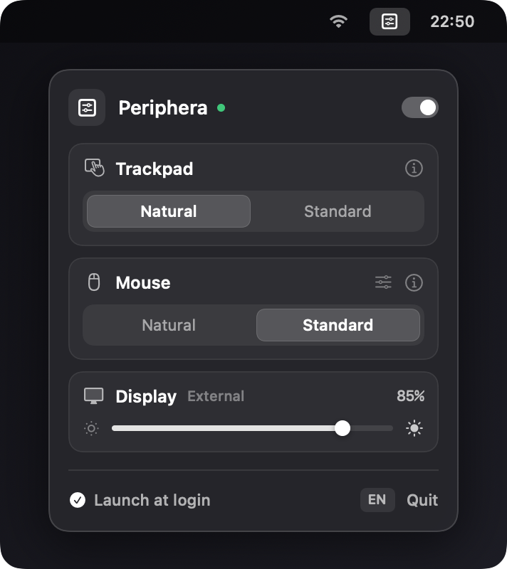
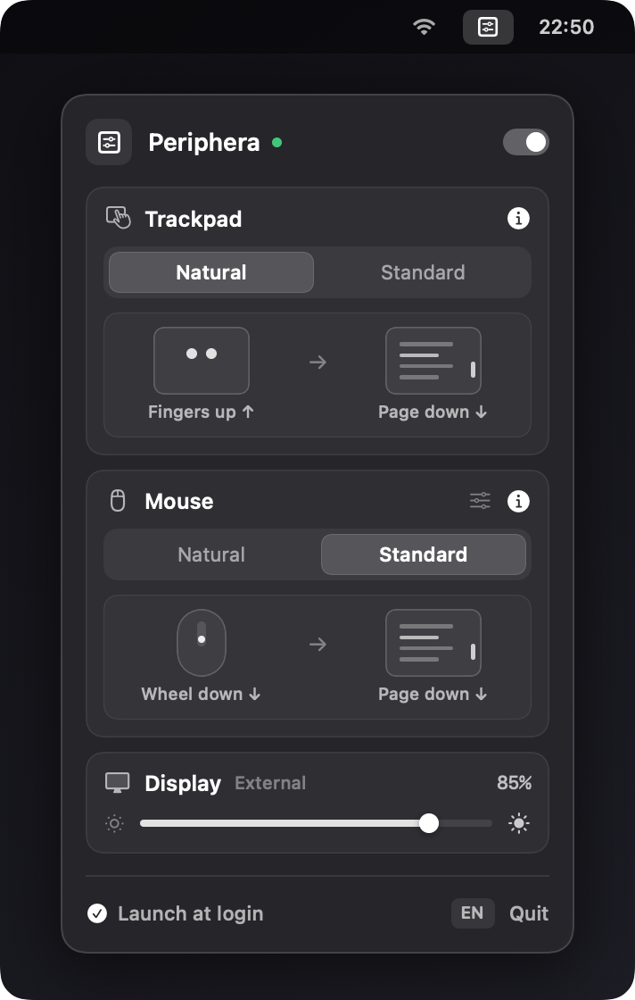

<div align="center">
  
  <h1>Periphera</h1>
  <p><strong>Independent scroll direction for Trackpad & Mouse + External Display brightness control on macOS.</strong></p>

  <p>
    <a href="https://github.com/carlosiccardi/Periphera/releases/latest/download/Periphera.dmg">
      
    </a>
  </p>
</div>

---

## Preview

<div align="center">
  <table>
    <tr>
      <td align="center"><strong>Minimal View</strong></td>
      <td align="center"><strong>Interactive <code>(i)</code> Simulator</strong></td>
    </tr>
    <tr>
      <td valign="top"></td>
      <td valign="top"></td>
    </tr>
  </table>
</div>

---

## Overview

Even in 2026, macOS still forces a single global toggle for "Natural Scrolling" across both your Trackpad and external Mouse, and offers no built-in brightness slider for third-party external monitors. **Periphera** is an ultra-lightweight, native macOS menu bar utility that solves both in one minimal popover.

## Features

- **Independent Scroll Directions**: Set **Natural** or **Standard** independently for your Trackpad and external Mouse.
- **External Display Brightness Control**: Smoothly adjust the brightness of any connected external monitor (`10%` – `100%`) using hybrid hardware DDC/CI (`IOAVService`) and CoreGraphics LUT scaling.
- **Zero-Latency Native Engine**: Built on CoreGraphics (`CGEventTap`) in Swift 6; preserves native macOS trackpad inertia, rubber-banding, and swipe gestures.
- **Pure Menu Bar Agent**: Runs silently in the background (`LSUIElement`) with zero Dock clutter and optional Launch at Login.
- **Interactive Visual Simulator**: Built-in minimal `(i)` animated preview showing finger/wheel gesture vs. page movement.
- **Mouse Wheel Calibration**: Optional wheel speed multiplier (`0.5x` – `2.5x`) and horizontal scroll inversion.
- **Multi-Language (`EN` / `IT`)**: Automatically adapts to system language with an instant in-app toggle.

---

## Installation

1. [**Download `Periphera.dmg`**](https://github.com/carlosiccardi/Periphera/releases/latest/download/Periphera.dmg) from the [Releases](https://github.com/carlosiccardi/Periphera/releases) page.
2. Drag **Periphera.app** into your `/Applications` folder and launch it.
3. Grant **Accessibility** permission when prompted (*System Settings → Privacy & Security → Accessibility*).

## Build from Source

```bash
chmod +x create_dmg.sh
./create_dmg.sh
```
