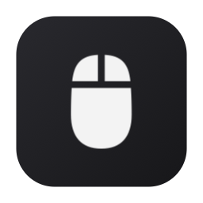
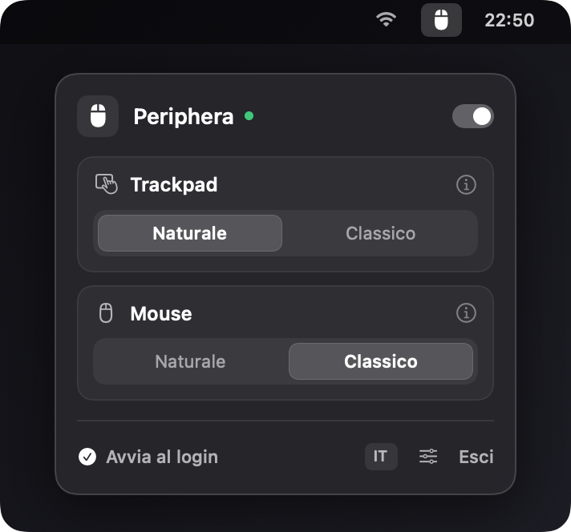
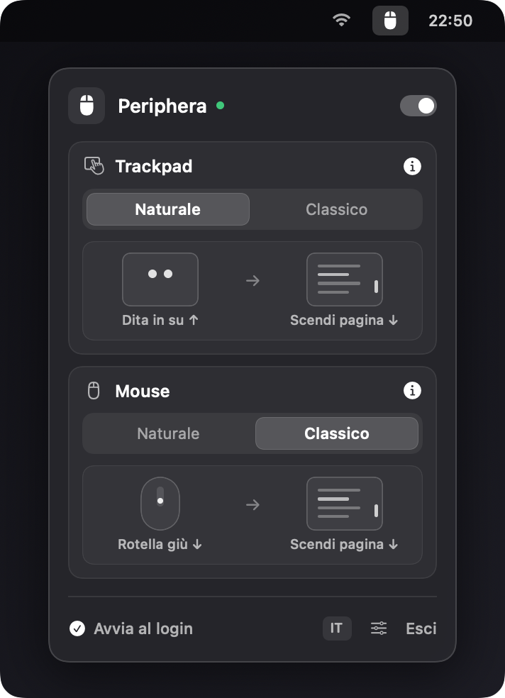

<div align="center">
  
  <h1>Periphera</h1>
  <p><strong>Independent scroll direction for Trackpad and Mouse on macOS.</strong><br/><em>Scorrimento indipendente per Trackpad e Mouse su macOS.</em></p>

  <p>
    <a href="https://github.com/carlosiccardi/Periphera/releases/latest/download/Periphera.dmg">
      
    </a>
  </p>
</div>

---

## Preview / Anteprima

<div align="center">
  <table>
    <tr>
      <td align="center"><strong>Minimal View</strong><br/><em>Vista Minimale</em></td>
      <td align="center"><strong>Interactive <code>(i)</code> Simulator</strong><br/><em>Simulatore <code>(i)</code> Interattivo</em></td>
    </tr>
    <tr>
      <td valign="top"></td>
      <td valign="top"></td>
    </tr>
  </table>
</div>

---

## EN — Overview

Even in 2026, macOS still forces a single global toggle for "Natural Scrolling" across both your Trackpad and external Mouse. **Periphera** is an ultra-lightweight, native macOS menu bar utility that decouples them—so you can keep **Natural scrolling** on your Trackpad and **Standard (Classic) wheel scrolling** on your Mouse.

### Features
- **Independent Scroll Directions**: Set **Natural** or **Standard** independently for Trackpad and external Mouse.
- **Zero-Latency Native Engine**: Built on CoreGraphics (`CGEventTap`) in Swift 6; preserves native macOS trackpad inertia, rubber-banding, and swipe gestures.
- **Pure Menu Bar Agent**: Runs silently in the background (`LSUIElement`) with zero Dock clutter.
- **Interactive Visual Simulator**: Built-in minimal `(i)` animated preview showing finger/wheel gesture vs. page movement.
- **Mouse Wheel Calibration**: Optional wheel speed multiplier (`0.5x` – `2.5x`) and horizontal scroll inversion.
- **Bilingual (`EN` / `IT`)**: Automatically adapts to system language with an instant in-app toggle.

---

## IT — Panoramica

Anche nel 2026, macOS continua a legare lo "Scorrimento naturale" del Trackpad a quello del Mouse esterno con un unico interruttore globale. **Periphera** è un'app nativa da barra dei menu, minimale e invisibile nel Dock, che separa i due dispositivi permettendoti di usare lo scorrimento **Naturale** sul Trackpad e **Classico** sulla rotella del Mouse.

### Caratteristiche
- **Direzioni Indipendenti**: Configura separatamente **Naturale** o **Classico** per Trackpad e Mouse.
- **Motore Nativo a Latenza Zero**: Basato su `CGEventTap` in Swift 6; mantiene intatti tutti i gesti multi-touch e l'inerzia nativa del Trackpad.
- **Invisibile nel Dock**: Gira esclusivamente in background nella barra superiore (`LSUIElement`), con avvio automatico al login.
- **Simulatore Visivo Integrato**: Premendo sulla `(i)` mostra una micro-animazione del gesto su Trackpad/Mouse e l'effetto corrispondente sulla pagina.
- **Calibrazione Rotella Mouse**: Moltiplicatore di velocità (`0.5x` – `2.5x`) e inversione opzionale dell'asse orizzontale.
- **Bilingue (`IT` / `EN`)**: Rilevamento automatico della lingua di sistema con selettore rapido integrato.

---

## Installation / Installazione

1. [**Download `Periphera.dmg`**](https://github.com/carlosiccardi/Periphera/releases/latest/download/Periphera.dmg) from the [Releases](https://github.com/carlosiccardi/Periphera/releases) page.
2. Drag **Periphera.app** into your `/Applications` folder and launch it.
3. Grant **Accessibility** permission when prompted (*System Settings → Privacy & Security → Accessibility*).

## Build from Source

```bash
chmod +x create_dmg.sh
./create_dmg.sh
```
